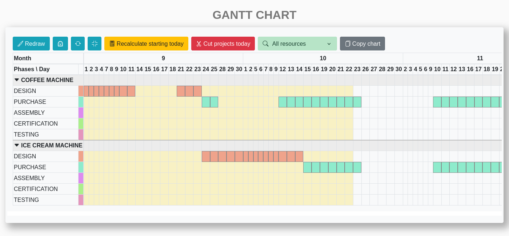
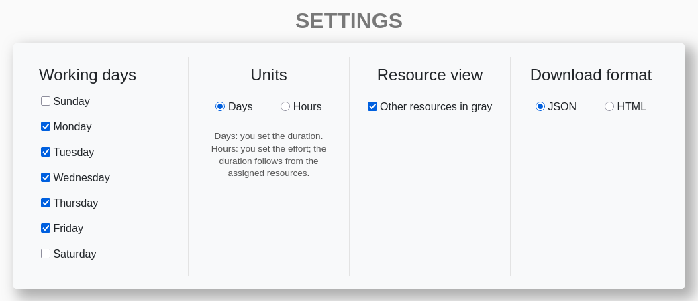
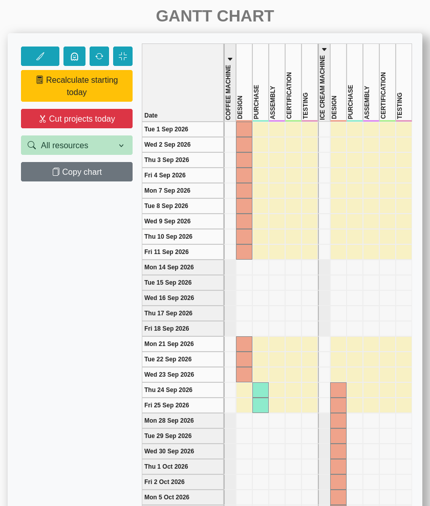
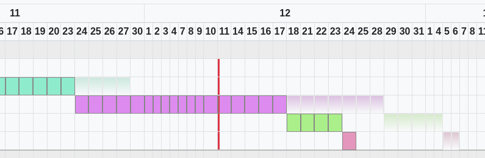
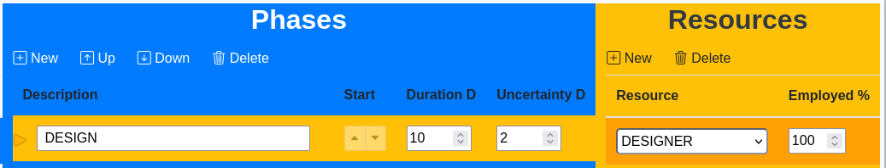
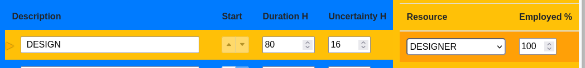
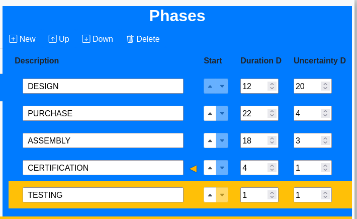

+++
date = '2026-10-23T17:00:00+02:00'
draft = false
math = true
title = "EasyGANTT 0.5.1: pianificare simulando l'incertezza"

description = "EasyGANTT 0.5 introduce la timeline verticale, il Gantt fantasma per l'incertezza, le durate in ore e i riferimenti di start: un simulatore per esplorare decisioni, non solo un disegno del progetto."

summary = "EasyGANTT 0.5.1: timeline verticale, Gantt fantasma, durate in ore e riferimenti di start. Un Gantt che si usa come simulatore."

categories = ["Software"]
tags = ["easygantt", "gantt", "project management", "open source"]

author = "Paolo Zambetti"

[cover]
image = "copertina.png"
alt = "EasyGANTT 0.5.1: il grafico con la proiezione dell'incertezza"
caption = ""
relative = true
hidden = false

ShowToc = true
TocOpen = false
+++

Nel 2024 ho lanciato il progetto EasyGANTT e oggi, grazie all’uso di agenti AI, ho implementato numerose modifiche. È un software libero per pianificare progetti con il diagramma di Gantt, ma è soprattutto utile per esplorare decisioni. Inserisci i progetti con le loro fasi, consecutive o parallele, definisci le risorse che le eseguono, le ferie, le date di consegna e le penali: il programma calcola il calendario, il livellamento delle risorse, i ritardi e il costo delle penali. Il tutto con una grafica chiara e intuitiva.

Non nasce per produrre un diagramma da stampare, ma per rispondere a una domanda concreta: **su cosa conviene lavorare adesso?** Cambi una priorità, una durata, una risorsa o una data e vedi subito l'effetto sul resto del piano. In questo senso EasyGANTT è un simulatore, non un semplice disegno.

Funziona interamente nel browser: nessun server, nessun account. I dati restano nel tuo computer e puoi esportarli in JSON o in un file HTML autonomo.

La versione **0.4.0** aveva sistemato le fondamenta: calendario e giorni lavorativi, gestione delle ferie, import/export e una prima cronologia di undo/redo. Dalla 0.5 il programma fa un salto: il grafico diventa esplorabile, l'incertezza entra nel piano e la durata può essere pensata come lavoro, non solo come giorni.

*Il grafico orizzontale: toolbar, grafico e pulsante del fantasma.*

## Un'interfaccia più chiara

La dashboard raccoglie i comandi principali e la navigazione tra le sezioni: progetti, risorse, Gantt, tabella dei ritardi e impostazioni.

Le impostazioni sono state riorganizzate in blocchi compatti:

- **Working days**: quali giorni della settimana sono lavorativi.
- **Units**: durata e incertezza in giorni oppure in ore.
- **Resource view**: quando evidenzi una risorsa, le fasi delle altre risorse possono restare visibili in grigio.
- **Download format**: JSON per un backup portabile, HTML per un file che riapre EasyGANTT con i dati già caricati.

*Le impostazioni: giorni lavorativi, unità, vista risorse e formato di export.*

## La timeline verticale

Il grafico può avere due orientamenti: orizzontale, con i giorni come colonne, oppure una **timeline verticale**, con i giorni come righe. Questo orientamento mi ha sorpreso, è molto intuitivo e si abbina naturalmente allo scorrimento della pagina. La densità normale usa una riga o una colonna per ogni giorno lavorativo; la densità condensata mostra solo le date in cui cambia qualcosa: l’inizio e la fine delle fasi, le consegne, le ferie.

Accanto a Redraw ci sono i pulsanti per ruotare il grafico, cambiare densità e accendere o spegnere il fantasma.

*La stessa pianificazione letta in verticale, con la toolbar sulla sinistra.*

## Il Gantt fantasma

Ogni fase può avere un tempo di **incertezza**. EasyGANTT calcola una seconda pianificazione, il fantasma, che tiene conto di queste incertezze e la disegna in una tinta più chiara e sfumata dietro il piano base, che resta a colore pieno.

Il fantasma non si consuma con il passare dei giorni. Sparisce solo quando la fase del piano base termina, oppure quando la dichiari conclusa. Il valore di incertezza resta comunque nei dati di input, pronto per essere modificato o riutilizzato.

Il pulsante con il fantasmino accende e spegne il fantasma. La copia del grafico negli appunti, invece, riporta sempre e solo il piano base, perché serve a condividere il piano, non la sua simulazione.

Nella modalità giorni si può trascinare l'ultima cella della barra per allungare o accorciare la fase, oppure usare il menu contestuale per dichiararla finita. Nella modalità ore il trascinamento è disattivato, perché la durata non è più un valore indipendente.

*Esempio: i tratti chiari sono il fantasma, cioè il grafico base con le incertezze di ogni fase. Si nota facilmente la differenza temporale tra il grafico base e il suo fantasma.*

## Durata in giorni o in ore
Fino alla 0.4.0 la durata era sempre espressa in giorni. Ora il progetto può
usare due metodi diversi, non solo due unità di misura.

**Days: durata fissata.** Imposti quanti giorni lavorativi deve durare la fase.
Le risorse sono vincoli: se sono occupate o in ferie la fase può aspettare, ma
aggiungerne una non accorcia la durata pianificata. Serve quando la durata è nota
o fissata dall'esterno.

**Hours: durata derivata dall'effort.** Imposti le ore di lavoro e la durata
viene calcolata:

$$
D(h) = \left\lceil \frac{h}{8C} \right\rceil
$$

\(C\) è la somma delle percentuali delle risorse della fase divisa per 100:
100% significa una risorsa a tempo pieno. Più capacità, meno giorni: 96 ore sono
12 giorni con una risorsa al 100%, 6 con due risorse a tempo pieno, 4 con tre.

Il cambio di unità converte i valori,
segnala gli arrotondamenti ed è annullabile.

In modalità ore il campo Duration contiene l'effort: la durata effettiva non si
modifica a mano, si cambiano le ore o le risorse.

La somma è quella delle risorse della fase: 100% significa una risorsa a tempo pieno. Aggiungere risorse accorcia la fase senza dover calcolare nulla. Per esempio, 96 ore con una risorsa al 100% sono 12 giorni; con due risorse sono 6 giorni; con tre sono 4.

L'incertezza segue la stessa unità del progetto: in modalità ore è espressa in ore e viene aggiunta come coda nel fantasma. Il cambio di unità converte i valori esistenti e avvisa degli arrotondamenti: l'operazione è annullabile.

In modalità ore il campo Duration contiene l'effort e la durata effettiva non si modifica a mano: si cambiano le ore o le risorse.

*La stessa tabella in modalità ore: Duration H e Uncertainty H. I giorni effettivi si vedono nel grafico.*

## Da dove parte una fase

I pulsanti su e giù nella colonna Start servono a posizionare l’inizio della fase rispetto a quelle precedenti. Un indicatore mostra dove si innesta la fase. È possibile iniziare insieme a una qualsiasi fase precedente oppure alla fine dell’ultima fase precedente. Lo scopo è ramificare il grafico senza perdere leggibilità. **Attenzione! Il livellamento dà priorità alle fasi più in alto.**

*TESTING parte dopo la fine di CERTIFICATION: il triangolo a destra sulla riga di CERTIFICATION indica l'ancora.*

## Strumenti e correzioni

La 0.5 porta anche alcuni strumenti che rendono il grafico più utile durante il lavoro:

- **Copy chart** produce una tabella compatta da incollare in un'email, senza immagini né JavaScript.
- La **vista per risorsa** colora i giorni in base alla percentuale di impiego; le altre risorse possono restare in grigio.
- **Download JSON/HTML**, salvataggio automatico nel browser e cronologia di undo/redo migliorata.
- La palette delle fasi è più satura e le intestazioni e i bordi delle tabelle sono allineati.

La 0.5.1 corregge inoltre alcuni dettagli importanti:

- il ritardo di un progetto usa la fase che finisce **per ultima**, non l'ultima della lista;
- l'angolo in alto a sinistra del grafico orizzontale resta fermo durante lo scorrimento;
- le risorse assegnate non hanno più linee grigie tra una riga e l'altra.

## Come provarlo

EasyGANTT è online su **[easygantt.net](https://easygantt.net)**: non serve installare nulla e non c'è un account. Puoi partire dai dati di esempio, modificare fasi e risorse, esportare il progetto e riaprirlo in un secondo momento.

Il codice è libero, distribuito con licenza **GPLv3**, e disponibile su [GitHub](https://github.com/ZambettiPaolo/ZambettiPaolo.github.io).
