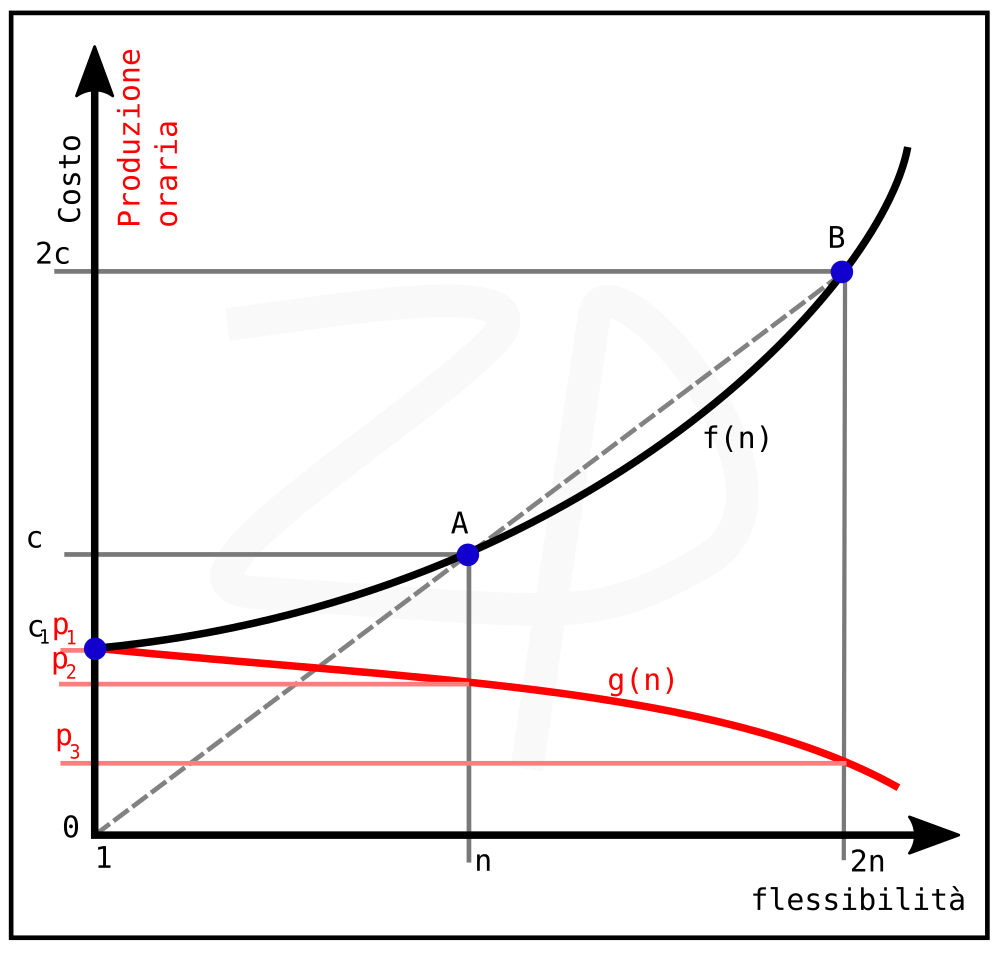

+++
date = '2026-08-21T17:09:56+02:00'
draft = true
title = 'Sulla flessibilità delle macchine'

description = ""
summary = ""

categories = ["Macchine"]
tags = []

author = "Paolo Zambetti"

[cover]
image = "copertina.png"
alt = "Descrizione"
caption = ""
relative = true
hidden = false

ShowToc = true
TocOpen = false
+++
Uno dei requisti più importanti di una macchina è la flessibilità, ovvero il numero di tipi di prodotto che può realizzare.

Perché non costruire una macchina universale che produce qualsiasi cosa? perché limitarsi a costruire una macchina che produce uno o pochi tipi? Qual è il limite della flessibilità? 

Per rispondere a queste domande analizziamo il costo di una macchina in funzione della sua flessibilità. Più tipi produce più meccanismi dovranno essere installati e, continuando ad aggiungerne, la macchina diventerà sempre più grande e complessa. è ragionevole pensare che la funzione costo-flessibilità c=f(n) sia una curva crescente che cresce sempre più rapidamente.

Possiamo vedere nel grafico costo-flessibilità che esistono una macchina A e una macchina B:

- la macchina A ha flessibilità n e costa c.

- la macchina B ha flessibilità doppia (2n) e costa il doppio (2c)! 
Contenuto dell’articolo

È dunque possibile costruire due macchine A che insieme producono gli stessi tipi di B allo stesso costo.

Non conviene costruire una macchina più flessibile di B perché due macchine flessibili la metà costano meno.

Viceversa conviene sempre costruire una macchina sola per flessibilità minore di B

Bisogna però dire che due macchine A possono produrre contemporaneamente due tipi diversi, quindi producono fino al doppio di B. Le macchine A sono più facili da utilizzare, da manutenere e richiedono meno competenze. 

Da cosa dipende la forma della funzione costo-flessibilità? l'impiego di nuove tecnologie, come le AI, può "spianare" la funzione ma anche i miglioramenti incrementali sulle nuove versioni.

Facciamo un altro passo e consideriamo anche la funzione produzione oraria p=g(n). Questa è una funzione decrescente perché all'aumentare della complessità della macchina bisognerà rinunciare alle soluzioni più veloci in favore di quelle più flessibili.

E' ancora macchina A che, grazie alla sua semplicità, produce di più.

Attenzione, la flessibilità va usata con moderazione! Anche se non sai quale tipo devi effettivamente produrre, non optare a priori per una macchina pronta a ogni evenienza:

Una macchina B produrrebbe molto meno (P3) al costo più alto (2c) invece che una macchina specializzata che produce al massimo (P1) al costo più basso (c1).

Tutto questo per dire che la scelta dei tipi che dovrà o dovranno produrre le macchine è molto importante. Durante lo sviluppo del progetto di una macchina potrebbe essere necessario e conveniente ridefinire l'insieme dei tipi. 

Ovviamente questa è solo una analisi qualitativa generale e non può essere diversamente visto che la f(n) reale non la conosciamo. 
